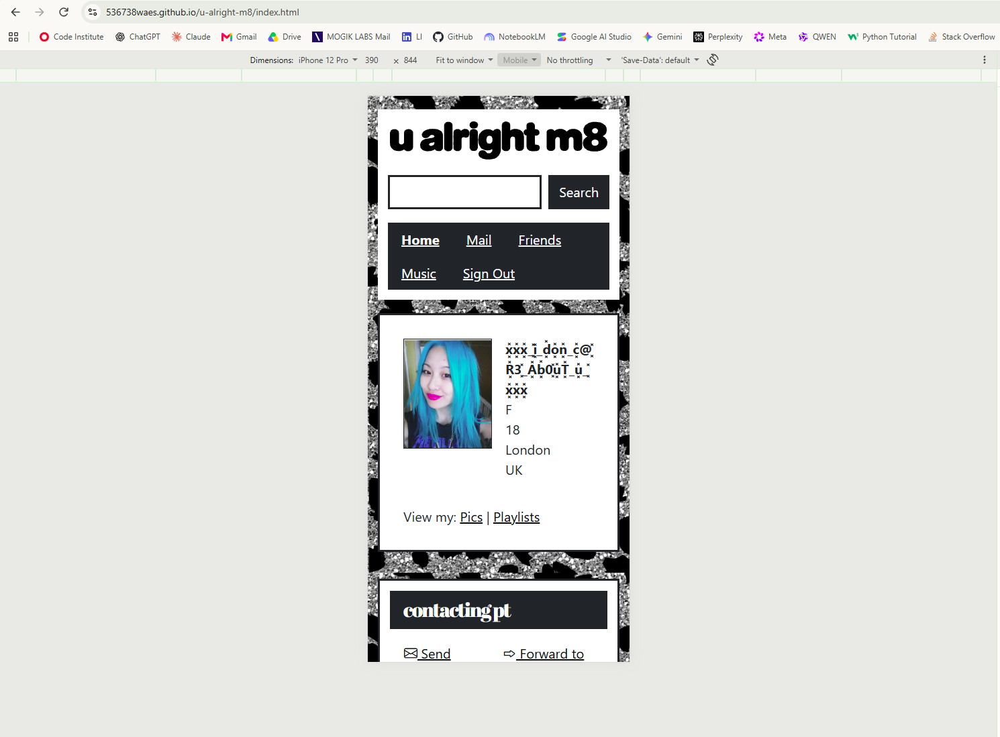
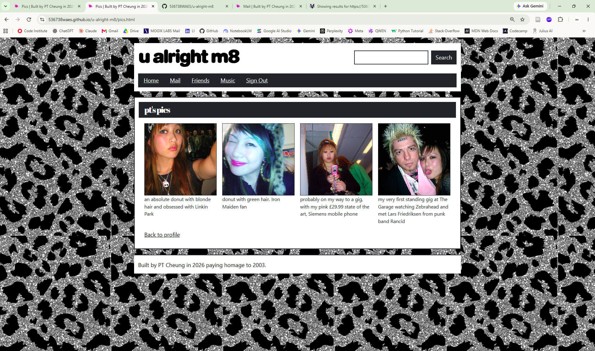
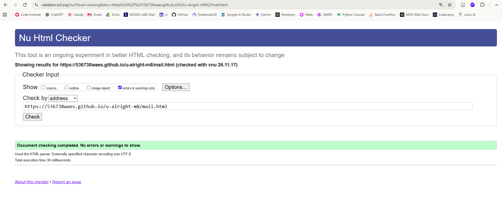
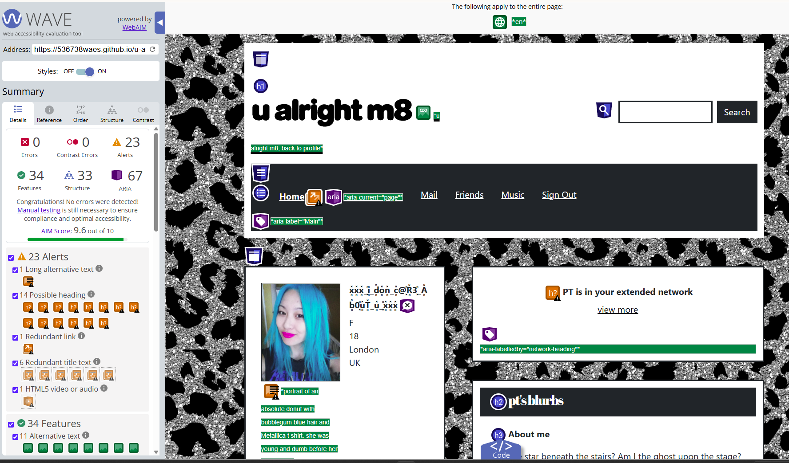
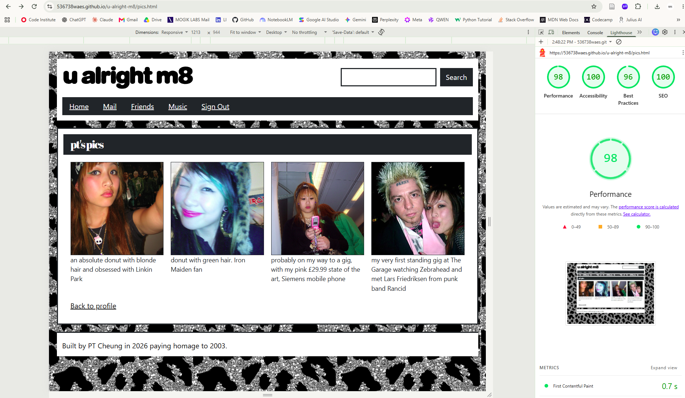
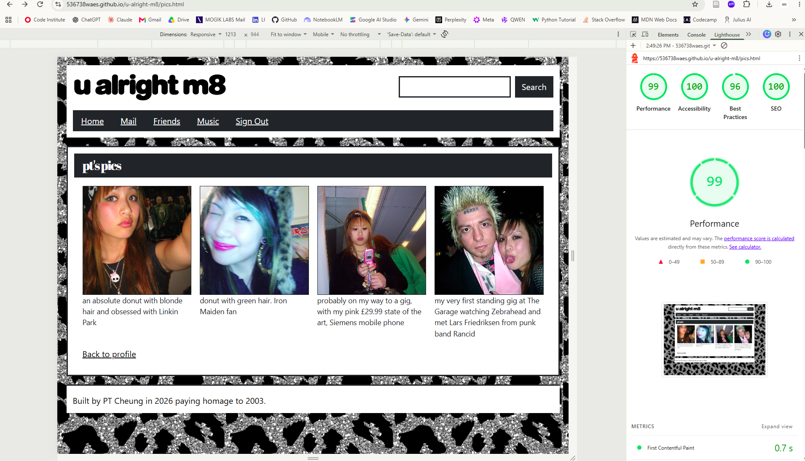
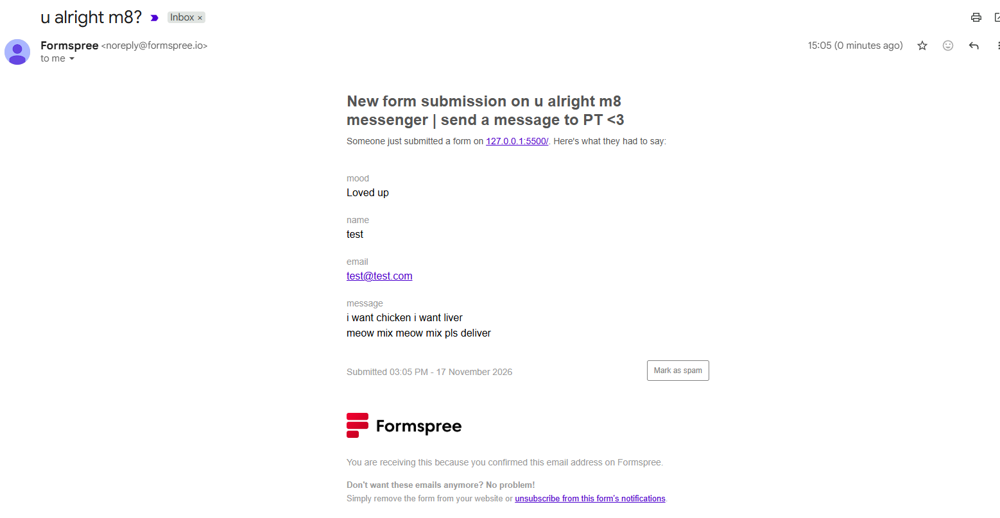
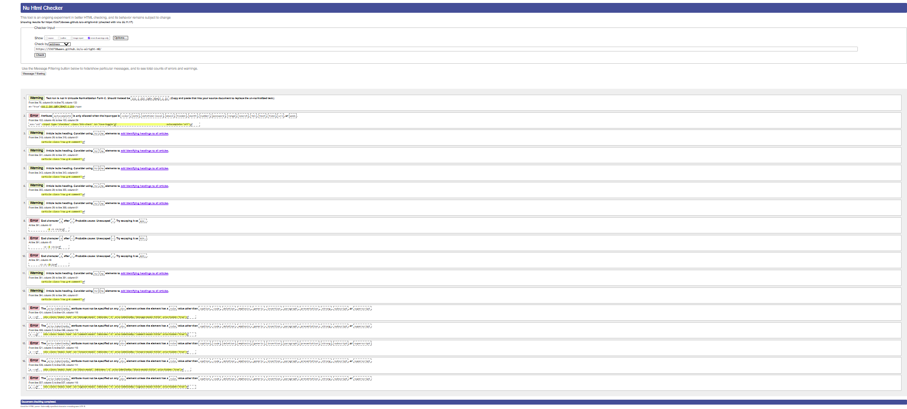

# u alright m8
Live site: https://536738waes.github.io/u-alright-m8/

A one-page, Y2K-era social profile page built with HTML, CSS and Bootstrap (+1.5% sneaky JavaScript for the media player ONLY due to there being no ActionScript/Flash widget equivalent in 2026.)

## Contents

- [Purpose](#purpose)
- [Features](#features)
- [Wireframes](#wireframes)
- [Testing](#testing)
- [Bugs](#bugs)
- [Deployment](#deployment)
- [Use of AI](#use-of-ai)
- [Credits](#credits)

## Purpose

Ahh.. lovely lovely MySpace. 
Before influencer culture, dance challenges and the age of AI generated slop. 
Remember when it wasn't worrying about how many friends you got but who deserved the top 8 friends in your grid? 
Or you discovered a great band you've never heard of on there because you saw/heard from someone's profile? 
With zero shred of icky gen-Z/alpha Y2K nostalgia you've seen on TikTok:  
made by someone who lived and breathed this scene in my youth, here is my recreation of my MySpace page in 2000s using 2026 code;  
a tribute to more innocent times of when we used social media the right way. 
Deliberately bare-bones HTML5 to reflect the era of social media during this time 
Also: SpaceHey is restricted to US only so I'm building this for the UK folks. 

## User value

The "Y2K" trend has always been a popular aesthetic / social media trend. 
It's a verstile light-weight site to repurpose for creative music marketing campaign(s) (e.g. a band/artist create their u alright m8 page as an addition to their marketing campaign.): 
Due to: 
- it's wholly customisable
- the music player is interactive and mp3 files can be directly uploaded in
- it's as close to an authentic MySpace page as a 2026 code offering can muster
- I'm sure there are many artists you can think of who has used the y2k trend in their music, social media - this will be a welcome addition to their marketing campaign; shared across modern social networks (like their Instagram, TikTok, YouTube)

## Features

### Header (all pages)
- **Logo:** clicks back to the profile from any page.
- **Search box:** sends what you type to a Google search, like the original site's search bar.
- **Navigation bar:** Home, Mail, Friends, Music and Sign Out. Sign Out opens a joke pop-up instead of logging anyone out.

### Profile page (index.html)
- **Profile box:** PT's photo, fancy-text display name (with a plain version for screen readers), gender, age, city and country, plus View my: Pics | Playlists links.
- **Contacting PT:** six links, all clickable:
  - Send Message and Instant Message open the messenger pop-up.
  - Add to Friends goes to PT's LinkedIn.
  - Add to Favourites is a star that fills in black when clicked and empties when clicked again (Bootstrap toggle, no JavaScript).
  - Forward to Friend and Block User open in-character pop-ups.
- **u alright m8 URL:** the site's own address as a clickable link.
- **Media player:** a retro silver player with a play button, scrolling track title, running time and a fold-out list of four tracks (Demo 1 to 4). The one script on the site, `player.js`, runs it.
- **Interests:** General and Music lists. The long band list scrolls inside its box so the left column ends level with the comments.
- **Extended network box:** "PT is in your extended network".
- **Blurbs:** an About me section.
- **Friend space (Top 8):** eight original characters with fancy-text names, each with a plain name for screen readers.
- **Friends comments:** "Displaying 7 of 6066 comments", seven comments from the Top 8 with 2006 timestamps, room for stickers, and a View all comments link. Add Comment opens a "only PT's friends can comment" pop-up that offers the messenger instead.

### Messenger (pop-up on index.html, full page on mail.html)
- **Mood strip:** six emoji moods (Happy, Loved up, Cool, Cheeky, Confused, Angry) to pick before writing.
- **Message form:** name, email and message, all required. Messages are sent through Formspree; after sending, the visitor sees Formspree's confirmation page.

### Pics page (pics.html)
- Four portraits in a square grid. Click any one to open it full size in a pop-up with a caption.

### Look and layout
- **Y2K styling:** black-and-white boxes with heavy borders, Abril Fatface headings and a tiled background behind a fixed-width, centred page.
- **Colour palette:** black and white with silver greys for the media player. Every colour is a CSS variable in `styles.css`.

  

- **Responsive:** two columns on laptops, stacking into one column on phones. The media player's side buttons hide on very small screens.
- **Custom cursors:** a Y2K heart-and-arrow cursor, with a winged heart over links and buttons, like the cursor sites everyone used in the 2000s. The normal typing cursor stays in text boxes.

   
- **Accessibility:** alt text on every image, plain-text versions of all fancy-text names, keyboard-usable pop-ups and a reduced-motion setting for the scrolling track title.

## Wireframes

Hand-drawn by PT before the build ([full PDF](assets/docs/wireframe.pdf)). Page 1 is the profile layout; page 2 is the friends comments box.

 

Changes from the wireframe during the build:

- Upcoming Shows and Blog Entry were dropped to keep the scope tight.
- General Info became the Interests box (General and Music).
- The media player moved to the left column, under the URL box.
- Add to Group and Rank User were removed from Contacting PT.

## Tools and technologies

### Languages and frameworks
- HTML5 and CSS3
- [Bootstrap 5.3.8](https://getbootstrap.com/): grid, cards, pop-ups (modals), the fold-out track list and the favourites toggle
- [Bootstrap Icons 1.11.3](https://icons.getbootstrap.com/): the icons in Contacting PT and the messenger mood strip
- JavaScript: one small script, `player.js`, for the media player only
- [Google Fonts](https://fonts.google.com/): Abril Fatface and UnifrakturMaguntia

### Services
- [Formspree](https://formspree.io/): sends messages from the messenger to PT's inbox
- [GitHub](https://github.com/) and GitHub Pages: version control and hosting

### Build and design tools
- Visual Studio Code with Live Server: writing and previewing the code
- Google Stitch: generated the media player prototype
- Claude Opus 5.5: build partner for code, debugging, prompt writing and the logo
- Google Flow Studio (Nano Banana Pro): the Top 8 friend pictures
- ElevenLabs Music: producing PT's Bach arrangements for the media player
- Sweezy Cursors: the heart cursors

### Screenshots

| Page | Desktop | Mobile |
|---|---|---|
| index.html |  |  |
| pics.html |  |  |
| mail.html |  |  |

## Testing

All checks were run on the live site on 17 November 2026.

| Test | Tool | Result |
|---|---|---|
| HTML, index.html | [W3C Nu HTML Checker](https://validator.w3.org/nu/) | No errors or warnings |
| HTML, pics.html and mail.html | W3C Nu HTML Checker | No errors or warnings |
| CSS | [W3C Jigsaw CSS Validator](https://jigsaw.w3.org/css-validator/) | No errors |
| JavaScript, player.js | [JSHint](https://jshint.com/) | No warnings |
| Messenger form | Test message sent to PT | Received by email with mood, name, email and message |
| Accessibility, index.html | [WAVE](https://wave.webaim.org/) | 0 errors, 0 contrast errors, AIM score 9.6 out of 10 |
| Lighthouse, all pages, desktop and mobile | [Lighthouse](https://developer.chrome.com/docs/lighthouse/) | 98 to 100 Performance, 100 Accessibility, 96 Best Practices, 100 SEO (see below) |

### HTML

### CSS

The CSS validator also lists warnings. These come from the CSS variables and from Bootstrap's own stylesheet, which the validator cannot check; they are not errors in the site's CSS.

### JavaScript

### Accessibility

WAVE also lists 23 alerts. These are prompts to check by hand, not failures: for example, bold lines it thinks might be headings, and the long description on the profile photo, which is kept on purpose.

### Lighthouse

| Page | View | Performance | Accessibility | Best Practices | SEO |
|---|---|---|---|---|---|
| index.html | Desktop | 98 | 100 | 96 | 100 |
| index.html | Mobile | 98 | 100 | 96 | 100 |
| pics.html | Desktop | 98 | 100 | 96 | 100 |
| pics.html | Mobile | 99 | 100 | 96 | 100 |
| mail.html | Desktop | 100 | 100 | 96 | 100 |
| mail.html | Mobile | 100 | 100 | 96 | 100 |

Best Practices was 96 on every page because of a missing favicon and two stickers without a set size (see Bugs and fixes).

### Messenger

## Bugs and fixes

| Bug | Cause | Fix |
|---|---|---|
| HTML checker showed 9 errors and 8 warnings on index.html | `<3` hearts read as tags, an `autocomplete` setting on the favourites tick box, pop-ups labelled without saying they were dialogs, unnormalised fancy text, comments without headings | `<3` written as `&lt;3`, setting removed, `role="dialog"` added to every pop-up, text normalised, friend names made into small headings |
| JSHint showed 9 warnings on player.js | JSHint checks against old JavaScript by default | Added `/* jshint esversion: 6 */` to the top of the file |
| Logo and footer unreadable on the background tile | Black text on a black-and-silver tile | White panels behind the header and footer |
| Custom cursors not showing | Cursor images were 128px, too big for most browsers | Resized to 32px |
| Lighthouse Best Practices 96: a 404 error and two unsized images | No favicon, and the heart and skull stickers had no width and height | Added a heart favicon to every page, and width and height to both stickers |

HTML checker before the fixes:

## Deployment

## AI reflection

### Code creation

### Debugging

### Performance and user experience

### Workflow

## Planned future updates

Kept out of this version on purpose, so the project stays focused on HTML, CSS and Bootstrap:

- **Friend profile pages:** a page for each of the Top 8, each with its own arrangement of the Bach piece in the media player. Templates are already drafted.
- **Real comments:** letting visitors post to the friends comments wall, which would need a server or database.
- **Staying on the page after sending a message:** would need more JavaScript or a paid Formspree plan.

## Credits

### Media player

- Reference: the original early-2000s profile screenshot from [Digital Native](https://www.digitalnative.tech/p/myspace-tumblr-and-the-long-lost), used as the visual brief for the player.
- Made with: Google Stitch, which generated the player's Bootstrap HTML, CSS and play controls from that reference.
- Merged by: PT Cheung, who brought the Stitch code into this site and fitted it to the layout, with the play controls in `player.js`.

### Asset log

Every image, sound and logo file in the site.

| File | What it is | Tool used or source | Date made | Terms checked |
|---|---|---|---|---|
| profile.jpg | PT's profile photo | Own photo | 2019 to 2023 | n/a |
| pic-3.jpeg to pic-6.jpeg | Four portraits on the Pics page | Own photo | 2019 to 2023 | n/a |
| friend-1.jpg to friend-8.jpg | Top 8 friend pictures (compressed 16 Nov 2026) | Prompts written with Claude Opus 5.5, images generated in Google Flow Studio (Nano Banana Pro), see screenshot below | 15 Nov 2026 | Partly |
| heart.gif | Sticker in the friends comments | Sourced from [Pinterest](https://in.pinterest.com/pin/993606736530510096/) | Nov 2026 | No: third-party Pinterest pin, original creator unknown |
| skull.gif | Sticker in the friends comments | Sourced from [Pinterest](https://uk.pinterest.com/ideas/gothic-myspace-layouts/893841263308/) | Nov 2026 | No: third-party Pinterest pin, original creator unknown |
| tile.jpg | Page background tile | Sourced from [Pinterest](https://in.pinterest.com/pin/684899055808782604/) | Nov 2026 | No: third-party Pinterest pin, original creator unknown |
| variation1.mp3 to variation4.mp3 | Demo 1 to 4 in the media player: PT Cheung's arrangements of J. S. Bach, BWV 478, from the public domain [IMSLP](https://clara.imslp.org/work/265053) edition | PT Cheung, produced with ElevenLabs Music | 12 Nov 2026 | Partly |
| artwork.jpg | Media player artwork | Sourced from [Digital Native](https://www.digitalnative.tech/p/myspace-tumblr-and-the-long-lost) | Nov 2026 | No: third-party image from an article |
| u-alright-m8-logo (black, white, primary) | Site logo, text only so it does not copy any existing logo | Made with Claude Opus 5.5 | 14 Nov 2026 | Partly |
| cursor.png, cursor-pointer.png | Custom 2000s-style cursor and link pointer | [Cute Y2K Heart, Sweezy Cursors](https://sweezy-cursors.com/cursor/cute-y2k-heart/) | 17 Nov 2026 | ? |

Friend pictures being generated in Google Flow Studio, 15 November 2026:

