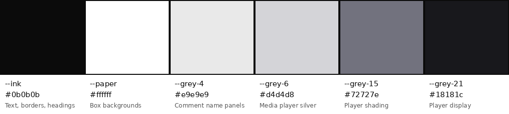
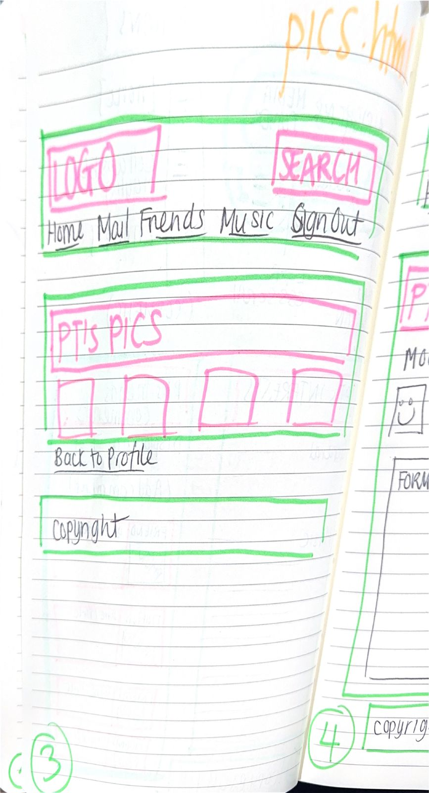
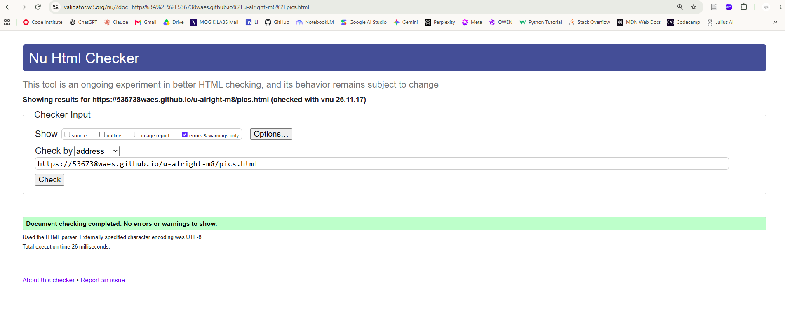
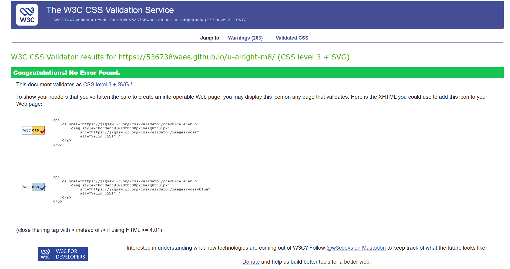
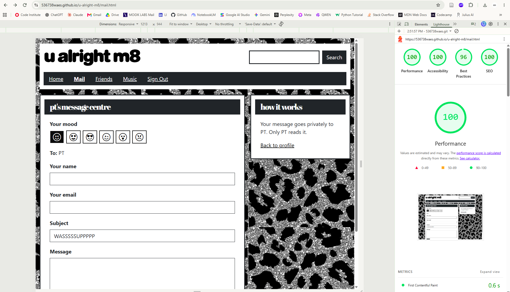

<h1>
  <picture>
    <source media="(prefers-color-scheme: dark)" srcset="assets/public/logos/u-alright-m8-logo-white.svg">
    
  </picture>
</h1>
https://536738waes.github.io/u-alright-m8/

A one-page, Y2K-era social profile page built with HTML, CSS and Bootstrap (+1.5% sneaky JavaScript for the media player ONLY due to there being no ActionScript/Flash widget equivalent in 2026.)

## Contents

- [Purpose](#purpose)
- [User stories](#user-stories)
- [Features](#features)
- [Wireframes](#wireframes)
- [Testing](#testing)
- [Bugs](#bugs)
- [Deployment](#deployment)
- [Use of AI](#use-of-ai)
- [Credits](#credits)

## Purpose

Ahh.. lovely lovely MySpace. 
Before influencer culture, dance challenges and AI generated slop. 
Your friend count didn't matter but who were the top 8 friends in your grid was priority 
Discovering a great band you've never heard of on someone's profile 
Exploring the newtro trend x Y2K nostalgia trends on TikTok:  
I made this because it made me nostalgic:  
MySpace was the pillar of my youth: music was my life (still is), emo girl profiles' shaped how I did my hair, dressed, listened to 
All the things that we loved and loved together were laid out on a simple page alongside music as a common vein alongside it 
Music on social media was never supposed to be background music to a post; 
Music is integral to your self identity just as your profile photo shows your face.  
This is my sincere tribute in 2026; a 2000 me built with 2026 code and AI tooling 
Deliberate bare-bones HTML5 to reflect the era of social media during this time 
Giving it genuine charm; relatable to those who was part of the MySpace days 
I give you u alright m8 - because I can't use MySpace legally, Justin Timberlake has the rights I believe 
Also: SpaceHey is restricted to US only so I'm building this for the UK folks. 
Here's your hit of nostalgia during a time where we're sick of Meta and TikTok sometimes. 

## User value

The "Y2K" trend has always been a popular aesthetic / social media trend. 
It's a verstile light-weight site to repurpose for creative music marketing campaign(s) (e.g. a band/artist create their u alright m8 page as an addition to their marketing campaign.): 
Due to: 
- it's wholly customisable
- the music player is interactive and mp3 files can be directly uploaded in
- it's as close to an authentic MySpace page as a 2026 code offering can muster
- I'm sure there are many artists you can think of who has used the y2k trend in their music, social media - this will be a welcome addition to their marketing campaign; shared across modern social networks (like their Instagram, TikTok, YouTube)

## User stories
Tracked on the [GitHub Projects board](https://github.com/users/536738WAES/projects/), prioritised with MoSCoW (must-have, should-have, could-have, won't-have).

| # | User story | Priority | Status |
|---|---|---|---|
| 1 | As a **visitor**, I want to see who PT is at a glance (photo, name, age, location) so that I know whose profile I'm on. | Must-have | Done |
| 2 | As a **visitor**, I want a clear navigation bar on every page so that I can move between the profile, pics and mail pages. | Must-have | Done |
| 3 | As a **mobile visitor**, I want the layout to fit my screen so that I can use the site on my phone. | Must-have | Done |
| 4 | As a **visitor**, I want to send PT a private message with a mood so that I can say hello like I would have in 2005. | Must-have | Done |
| 5 | As a **music fan**, I want to play, pause, skip through and switch tracks so that I can hear PT's music. | Must-have | Done |
| 6 | As a **visitor**, I want to see PT's Top 8 and friends' comments so that the profile feels lived-in and social. | Should-have | Done |
| 7 | As a **visitor**, I want to open PT's photos full size so that I can see them properly. | Should-have | Done |
| 8 | As a **screen reader user**, I want fancy-text names read out as plain text and every control usable by keyboard so that I can use the site too. | Should-have | Done |
| 9 | As a **nostalgic visitor**, I want little 2000s touches (custom cursor, favourites star, joke pop-ups) so that it feels like the real thing. | Could-have | Done |
| 10 | As a **visitor**, I want to click a Top 8 friend and visit their profile so that I can explore their world. | Could-have | Parked (future update) |
| 11 | As a **visitor**, I want to post a public comment so that everyone can see it. | Won't-have (needs a server) | Not planned |

## Features

### Header (all pages)
- **Logo:** clicks back to the profile from any page.
- **Search box:** sends what you type to a Google search, like the original site's search bar.
- **Navigation bar:** Home, Mail, Friends, Music and Sign Out. Sign Out opens a joke pop-up instead of logging anyone out.

### Profile page (index.html)
- **Profile box:** PT's photo, fancy-text display name (with a plain version for screen readers), gender, age, city and country, plus View my: Pics | Playlists links.
- **Contacting PT:** six links, all clickable:
  - Send Message and Instant Message open the messenger pop-up.
  - Add to Friends goes to PT's LinkedIn.
  - Add to Favourites is a star that fills in black when clicked and empties when clicked again (Bootstrap toggle, no JavaScript).
  - Forward to Friend and Block User open in-character pop-ups.
- **u alright m8 URL:** the site's own address as a clickable link.
- **Media player:** a retro silver player with a play button, scrolling track title, running time and a fold-out list of four tracks (Demo 1 to 4). The one script on the site, `player.js`, runs it.
- **Interests:** General and Music lists. The long band list scrolls inside its box so the left column ends level with the comments.
- **Extended network box:** "PT is in your extended network".
- **Blurbs:** an About me section.
- **Friend space (Top 8):** eight original characters with fancy-text names, each with a plain name for screen readers.
- **Friends comments:** "Displaying 7 of 6066 comments", seven comments from the Top 8 with 2006 timestamps, room for stickers, and a View all comments link. Add Comment opens a "only PT's friends can comment" pop-up that offers the messenger instead.

### Friend profile pages (friend-1.html to friend-8.html)

- **One per Top 8 friend:** click any friend in PT's Top 8 to visit their profile.
- **Same frame, eight colour stories:** the u alright m8 header, navigation and footer stay black and white on every page; each friend's profile area uses their own palette, set with the same five CSS variables (`--f-bg`, `--f-surface`, `--f-text`, `--f-accent`, `--f-on-accent`) on a class for that page.
- **Their own music:** each friend's media player plays their own reimagining of the Bach piece. PT's player plays all eight as the Top 8 album.
- **Their own world:** tagline, details, interests, blurbs, their own Top 4 or Top 8, and friends comments, all written in character.
- **Pics pages:** every friend's View my: Pics link opens their own pics page in the same click-to-enlarge style. JET's is the fullest; the others are lighter, with one or two photos each, so every link on every profile works.
- **Working Contacting box:** the same six links and pop-ups as PT's profile.
- **JET's page goes further:** JET is the lead guitarist of NOSFERA2, a fictional Tokyo rock band from PT's own wider creative project, so his page has extras:
  - **His own pics page** (jet-pics.html): seven photos in the same click-to-enlarge grid as PT's, with captions in his voice.
  - **A fixed band-logo background:** a plain black page with the NOSFERA2 logo pinned in the centre while the page scrolls over it (`background: ... no-repeat center center fixed`).
  - **His bandmates in his friend space:** the NOSFERA2 logo plus Dove, Tyson and (mm)Alice.
  - **His own cursors:** a sword, with a skull over links and buttons, set only for his page through the `.friend-1` class.
  - **Real versus engineered:** PT's photos are real, taken 2019 to 2023; JET's world is fully AI-generated. The contrast is deliberate.
- **Fictional URLs:** friend profile URLs (for example ualrightm8.com/JET) are fictional vanity addresses for the homage and are plain text, not links.

### Messenger (pop-up on index.html, full page on mail.html)
- **Mood strip:** six emoji moods (Happy, Loved up, Cool, Cheeky, Confused, Angry) to pick before writing.
- **Message form:** name, email and message, all required. Messages are sent through Formspree; after sending, the visitor sees Formspree's confirmation page.

### Pics page (pics.html)
- Four portraits in a square grid. Click any one to open it full size in a pop-up with a caption.

### Look and layout
- **Y2K styling:** black-and-white boxes with heavy borders, Abril Fatface headings and a tiled background behind a fixed-width, centred page.
- **Colour palette:** black and white with silver greys for the media player. Every colour is a CSS variable in `styles.css`.

  

- **Responsive layout:**
  - One centred container (`container-fluid`, max-width 1200px), like the fixed-width profiles of the 2000s, with the tiled background showing either side.
  - One row, two columns: left (`col-lg-5`) holds the profile, contact links, URL, media player and interests; right (`col-lg-7`) holds the network box, blurbs, Top 8 and comments.
  - Below 992px (`lg`) both columns become full width and stack, left column first. The breakpoint was moved up from `md` (768px) because tablets squashed the media player.
  - Top 8 grid: `row-cols-2 row-cols-sm-4`, 2 across on phones and 4 across from 576px.
  - Custom media query: the media player's side buttons hide under 400px.
- **Custom cursors:** a Y2K heart-and-arrow cursor, with a winged heart over links and buttons, like the cursor sites everyone used in the 2000s. The normal typing cursor stays in text boxes.

   
- **Accessibility:** alt text on every image, plain-text versions of all fancy-text names, keyboard-usable pop-ups and a reduced-motion setting for the scrolling track title.

## Wireframes

### Wireframe 1: initial plan

Hand-drawn by PT before the build ([full PDF](assets/docs/wireframe.pdf)). Page 1 is the profile layout; page 2 is the friends comments box.

 

Changes from the wireframe during the build:

- Upcoming Shows and Blog Entry were dropped to keep the scope tight.
- General Info became the Interests box (General and Music).
- The media player moved to the left column, under the URL box.
- Add to Group and Rank User were removed from Contacting PT.

### Wireframe 2: final layout

Redrawn by PT to match the finished site, one sketch per page. Green boxes are sections, pink boxes are headings and content. Full PDFs: [profile](assets/docs/wireframe-2-index.pdf), [pics](assets/docs/wireframe-2-pics.pdf), [mail](assets/docs/wireframe-2-mail.pdf).

 

 

## Tools and technologies

### Languages and frameworks
- HTML5 and CSS3
- [Bootstrap 5.3.8](https://getbootstrap.com/): grid, cards, pop-ups (modals), the fold-out track list and the favourites toggle
- [Bootstrap Icons 1.11.3](https://icons.getbootstrap.com/): the icons in Contacting PT and the messenger mood strip
- JavaScript: one small script, `player.js`, for the media player only
- [Google Fonts](https://fonts.google.com/): Abril Fatface and UnifrakturMaguntia

### Services
- [Formspree](https://formspree.io/): sends messages from the messenger to PT's inbox
- [GitHub](https://github.com/) and GitHub Pages: version control and hosting

### Build and design tools
- Visual Studio Code with Live Server: writing and previewing the code
- Google Stitch: generated the media player prototype
- Claude Opus 5.5: build partner for code, debugging, prompt writing and the logo
- Google Flow Studio (Nano Banana Pro): the Top 8 friend pictures
- ElevenLabs Music: producing PT's Bach arrangements for the media player
- Sweezy Cursors: the heart cursors

### Screenshots

| Page | Desktop | Mobile |
|---|---|---|
| index.html |  |  |
| pics.html |  |  |
| mail.html |  |  |

## Testing

All checks were run on the live site on 17 November 2026.

| Test | Tool | Result |
|---|---|---|
| HTML, index.html | [W3C Nu HTML Checker](https://validator.w3.org/nu/) | No errors or warnings |
| HTML, pics.html and mail.html | W3C Nu HTML Checker | No errors or warnings |
| CSS | [W3C Jigsaw CSS Validator](https://jigsaw.w3.org/css-validator/) | No errors |
| JavaScript, player.js | [JSHint](https://jshint.com/) | No warnings |
| Messenger form | Test message sent to PT | Received by email with mood, name, email and message |
| Accessibility, index.html | [WAVE](https://wave.webaim.org/) | 0 errors, 0 contrast errors, AIM score 9.6 out of 10 |
| Lighthouse, all pages, desktop and mobile | [Lighthouse](https://developer.chrome.com/docs/lighthouse/) | 98 to 100 Performance, 100 Accessibility, 96 Best Practices, 100 SEO (see below) |

### HTML

### CSS

The CSS validator also lists warnings. These come from the CSS variables and from Bootstrap's own stylesheet, which the validator cannot check; they are not errors in the site's CSS.

### JavaScript

### Accessibility

WAVE also lists 23 alerts. These are prompts to check by hand, not failures: for example, bold lines it thinks might be headings, and the long description on the profile photo, which is kept on purpose.

### Lighthouse

| Page | View | Performance | Accessibility | Best Practices | SEO |
|---|---|---|---|---|---|
| index.html | Desktop | 98 | 100 | 96 | 100 |
| index.html | Mobile | 98 | 100 | 96 | 100 |
| pics.html | Desktop | 98 | 100 | 96 | 100 |
| pics.html | Mobile | 99 | 100 | 96 | 100 |
| mail.html | Desktop | 100 | 100 | 96 | 100 |
| mail.html | Mobile | 100 | 100 | 96 | 100 |

Best Practices was 96 on every page because of a missing favicon and two stickers without a set size (see Bugs and fixes).

### Messenger

## Bugs and fixes

| Bug | Cause | Fix |
|---|---|---|
| HTML checker showed 9 errors and 8 warnings on index.html | `<3` hearts read as tags, an `autocomplete` setting on the favourites tick box, pop-ups labelled without saying they were dialogs, unnormalised fancy text, comments without headings | `<3` written as `&lt;3`, setting removed, `role="dialog"` added to every pop-up, text normalised, friend names made into small headings |
| JSHint showed 9 warnings on player.js | JSHint checks against old JavaScript by default | Added `/* jshint esversion: 6 */` to the top of the file |
| Logo and footer unreadable on the background tile | Black text on a black-and-silver tile | White panels behind the header and footer |
| Custom cursors not showing | Cursor images were 128px, too big for most browsers | Resized to 32px |
| Lighthouse Best Practices 96: a 404 error and two unsized images | No favicon, and the heart and skull stickers had no width and height | Added a heart favicon to every page, and width and height to both stickers |
| Navigation links stayed blue instead of white | Bootstrap's link colour variable overrode the custom colour | A direct `.main-nav .nav-link` colour rule in styles.css |
| Pop-up headings were invisible | The global black `h2` colour beat the white header background | Added Bootstrap's `text-white` class to each pop-up heading |
| Add Comment opened the private messenger, which made visitors think their comment would appear publicly | No server to store public comments | Add Comment now opens a "only PT's friends can comment" pop-up that offers the messenger instead |
| New features missing from the live site after pushing | Later changes had been saved but not committed | Committed the remaining files, pushed, and hard-refreshed the live page |
| Interests box made the page far longer than the comments column | Long band list | The box now ends level with the comments and the list scrolls inside it (CSS only) |
| Media player could not be skipped through | No progress bar | Added a range slider wired into player.js |
| Page scrolled sideways on phones (13px) | The wide column gap (`gx-5`) was bigger than the page edge on small screens | Gap is now small on phones and wide only on laptops (`gx-3 gx-lg-5`) |
| Tablets (768px) squeezed two columns, so the media player display was only 69px wide and the Top 8 pictures 74px | The two-column layout started at Bootstrap's `md` breakpoint | Two columns now start at `lg` (992px); tablets get one full-width column |
| Profile page was 7,700px long on phones | The full band list showed at full height | On phones and tablets the interests list is capped and scrolls inside its box, cutting the page to 4,700px |

HTML checker before the fixes:

## Deployment

The site is deployed with GitHub Pages:

1. The code is stored in the GitHub repository [536738WAES/u-alright-m8](https://github.com/536738WAES/u-alright-m8).
2. In the repository, go to **Settings**, then **Pages**.
3. Under **Build and deployment**, set Source to **Deploy from a branch**.
4. Set Branch to **main** and the folder to **/ (root)**, then click **Save**.
5. GitHub builds the site and publishes it at https://536738waes.github.io/u-alright-m8/
6. Every push to the main branch updates the live site automatically, usually within a minute or two.

The live site matches the main branch: every check in Testing was run on the deployed version.

To run it locally: clone the repository, open the folder in VS Code and open `index.html` with the Live Server extension.

## AI reflection

### Code creation

### Debugging

### Performance and user experience

### Workflow

## Planned future updates

Kept out of this version on purpose, so the project stays focused on HTML, CSS and Bootstrap:

- **Friend profile pages:** a page for each of the Top 8, each with its own arrangement of the Bach piece in the media player. Templates are already drafted.
- **Real comments:** letting visitors post to the friends comments wall, which would need a server or database.
- **Staying on the page after sending a message:** would need more JavaScript or a paid Formspree plan.
- **Add to playlist:** the media player's **+** button would open an "add to playlist" menu, so visitors could build their own playlists while browsing profiles, like the original site's 2010 music player ([reference](https://www.jblogg.com/2010how-to-make-playlists-on-myspace-music/)). This needs more JavaScript than this project allows, so the **+** button is cosmetic for now.

## Credits

### Media player

- Reference: the original early-2000s profile screenshot from [Digital Native](https://www.digitalnative.tech/p/myspace-tumblr-and-the-long-lost), used as the visual brief for the player.
- Made with: Google Stitch, which generated the player's Bootstrap HTML, CSS and play controls from that reference.
- Merged by: PT Cheung, who brought the Stitch code into this site and fitted it to the layout, with the play controls in `player.js`.

### Asset log

Every image, sound and logo file in the site.

| File | What it is | Tool used or source | Date made | Terms checked |
|---|---|---|---|---|
| profile.jpg | PT's profile photo | Own photo | 2019 to 2023 | n/a |
| pic-3.jpeg to pic-6.jpeg | Four portraits on the Pics page | Own photo | 2019 to 2023 | n/a |
| friend-1.jpg to friend-8.jpg | Top 8 friend pictures (compressed 16 Nov 2026) | Prompts written with Claude Opus 5.5, images generated in Google Flow Studio (Nano Banana Pro), see screenshot below | 15 Nov 2026 | Partly |
| heart.gif | Sticker in the friends comments | Sourced from [Pinterest](https://in.pinterest.com/pin/993606736530510096/) | Nov 2026 | No: third-party Pinterest pin, original creator unknown |
| skull.gif | Sticker in the friends comments | Sourced from [Pinterest](https://uk.pinterest.com/ideas/gothic-myspace-layouts/893841263308/) | Nov 2026 | No: third-party Pinterest pin, original creator unknown |
| tile.jpg | Page background tile | Sourced from [Pinterest](https://in.pinterest.com/pin/684899055808782604/) | Nov 2026 | No: third-party Pinterest pin, original creator unknown |
| pt/variation1.mp3 to pt/variation4.mp3 | Demo 1 to 4 in the media player: PT Cheung's arrangements of J. S. Bach, BWV 478, from the public domain [IMSLP](https://clara.imslp.org/work/265053) edition | PT Cheung, produced with ElevenLabs Music | 12 Nov 2026 | Partly |
| One mp3 in each friend's folder in assets/audio (all eight Top 8 friends) | The Top 8 album: one reimagining of Bach's BWV 478 per friend, each in that friend's style, played on each friend's page and as a playlist on PT's profile | PT Cheung, produced with ElevenLabs Music | 18 Nov 2026 | Partly |
| artwork.jpg | Media player artwork | Sourced from [Digital Native](https://www.digitalnative.tech/p/myspace-tumblr-and-the-long-lost) | Nov 2026 | No: third-party image from an article |
| u-alright-m8-logo (black, white, primary) | Site logo, text only so it does not copy any existing logo | Made with Claude Opus 5.5 | 14 Nov 2026 | Partly |
| m8-mark (black, white, silver), m8-favicon (SVG, 32px, 180px), u-alright-m8-social-preview.png | The m8 brand mark used as the favicon on every page, plus the GitHub social preview image | Cut from the u alright m8 wordmark with Claude Opus 5.5; preview built on tile.jpg | 20 Nov 2026 | Yes |
| nosfera2.jpg | NOSFERA2 band logo in JET's friend space, reformatted to a square thumbnail | PT Cheung's own artwork (from a separate personal project) | 20 Nov 2026 | n/a |
| dove.jpg, tyson.jpg, alice.jpg | NOSFERA2 band members' profile pictures in JET's friend space (Dove also in JET's comments) | Generated by PT from her own NOSFERA2 artwork (Nano Banana Pro / ChatGPT); compressed 20 Nov | 20 Nov 2026 | Partly |
| jet/ folder: jet-guitar, ysl, photoshoot, thewhisky, jet, gyaruo, backstage (.jpg) | The seven photos on JET's pics page (jet-pics.html) | PT Cheung's own NOSFERA2 artwork from a separate personal project; resized and compressed 20 Nov | 20 Nov 2026 | Partly |
| jet/cursor.png, jet/pointer.png | JET's page only: sword cursor and skull link pointer (resized to 32px) | Sweezy Cursors | 20 Nov 2026 | ? |
| glitter-jelly-princess/pic-1.jpg | The photo on glitter jelly princess's pics page (friend-2-pics.html) | PT Cheung, AI-generated character artwork | 20 Nov 2026 | Partly |
| cursor.png, cursor-pointer.png | Custom 2000s-style cursor and link pointer | [Cute Y2K Heart, Sweezy Cursors](https://sweezy-cursors.com/cursor/cute-y2k-heart/) | 17 Nov 2026 | ? |

Friend pictures being generated in Google Flow Studio, 15 November 2026:

